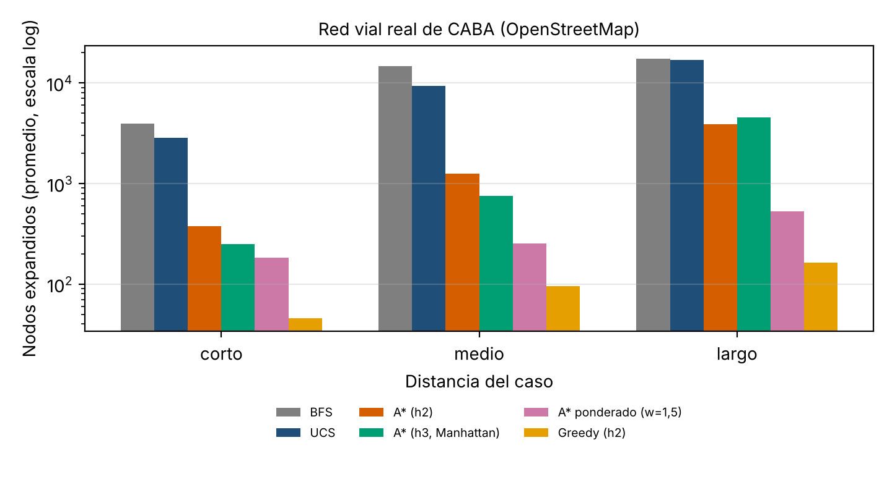
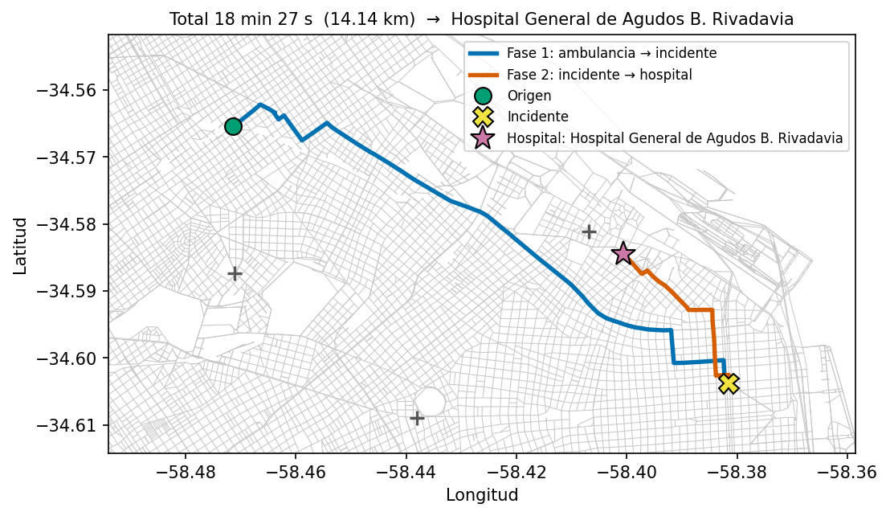

# Ruteo de ambulancias en CABA como problema de búsqueda

[](https://colab.research.google.com/github/Agustin327/Trabajo-Integrador-AA/blob/main/notebooks/ambulancias.ipynb)

 [Informe completo (PDF)](Informe-TP-Integrador.pdf)

Dada una ambulancia y un incidente, se busca la ruta de **menor tiempo** ambulancia → incidente → hospital de guardia,
sobre la red vial real de la Ciudad de Buenos Aires. El trabajo modela el problema como un problema de búsqueda en
grafos e implementa y compara **BFS, Dijkstra, A, A ponderado\* y búsqueda voraz (greedy)**.

**Utilidad:** reducir el tiempo de respuesta en emergencias, medir qué zonas quedan lejos de un hospital con guardia y
apoyar decisiones sobre dónde ubicar bases de ambulancias.

## Formulación del problema

| Elemento | Definición |
|---|---|
| Estado | `(nodo, fase)`: el nodo es una intersección; fase 0 = va hacia el paciente, fase 1 = lleva al paciente al hospital |
| Estado inicial | `(nodo_ambulancia, 0)` |
| Acciones | avanzar por una arista saliente del nodo; **se respetan los sentidos de calle** (grafo dirigido) |
| Transición | al llegar al nodo del incidente en fase 0, el estado pasa a fase 1 con costo 0 |
| Test de meta | estar en el nodo de alguno de los 14 hospitales, en fase 1 |
| Costo de camino | suma de `longitud(arista) / v` (segundos), con `v = 46 km/h` constante |

La elección del hospital destino forma parte de la búsqueda: la solución es la que minimiza el tiempo total
(fase 1 + fase 2) entre todos los hospitales posibles.

**Observación:** como `v` es constante, minimizar el tiempo equivale a minimizar la distancia. `v` solo escala los
tiempos reportados, no cambia la ruta óptima ni el número de nodos expandidos.

## Algoritmos sin heurística

- **BFS :** ignora los costos; devuelve el camino con menos aristas . Solo de referencia.
- **Dijkstra** (búsqueda de costo uniforme): expande por costo acumulado; es el óptimo de referencia.

## Heurísticas

Sea `d(a, b)` la distancia en línea recta (haversine) y `H` el conjunto de hospitales.

- **h0 = 0:** equivale a Dijkstra. Referencia de optimalidad.
- **h2 (principal), para las dos fases:**
  - fase 0: `h2(n) = d(n, incidente)/v + min_{h∈H} d(incidente, h)/v`
  - fase 1: `h2(n) = min_{h∈H} d(n, h)/v`
- **h3 (Manhattan):** contraejemplo. En una ciudad con calles diagonales puede sobreestimar y dejar de ser admisible.
- **Greedy:** `f = h2`, ignora el costo acumulado.

**h2 es admisible**: una ruta por calles nunca es más corta que la línea recta y ninguna puede ser más rápida que `v`,
y tomar el mínimo sobre los hospitales no sobreestima. **Es consistente**: cumple la desigualdad triangular, y en el
cambio de fase ambos lados valen lo mismo (en el nodo del incidente las dos fases dan `min_h d(incidente, h)/v`).
Ambas propiedades se comprueban numéricamente en `src/pruebas.py`.

## Justificación del enfoque

- **Búsqueda en grafos y no aprendizaje automático.** El problema tiene un modelo completamente conocido (calles, sentidos, longitudes
  y velocidad), así que no hay nada que aprender de datos: lo que se necesita es encontrar el mejor camino. Eso es exactamente un problema
  de búsqueda, y permite garantizar la solución óptima en vez de aproximarla.
- **Grafo dirigido.** Las ambulancias deben respetar el sentido de las calles; un grafo no dirigido daría rutas imposibles.
- **Estado `(nodo, fase)`.** La ruta debe pasar por el incidente antes de ir al hospital. Con la fase en el estado, una sola búsqueda
  resuelve el recorrido completo y además elige el hospital que minimiza el tiempo total, sin probar los 14 por separado.
- **Costo en tiempo.** En una emergencia importa el tiempo, no la distancia. Con velocidad constante ambos coinciden, pero el modelo ya
  está planteado en tiempo para poder usar velocidades distintas por calle si se consiguen datos.
- **A\* con h2 como algoritmo principal.** La línea recta dividida por la velocidad nunca sobreestima el tiempo real, así que A\* devuelve
  siempre la ruta óptima pero expandiendo bastante menos nodos. Los demás algoritmos están para comparar y mostrar por qué no son la mejor opción para este problema; por ello se eligió, además, BFS como referencia, greedy como algoritmo que solo considera la heurística y costo uniforme como algoritmo que solo considera el costo.

## Datos

| Dato | Fuente |
|---|---|
| Red vial de CABA | OpenStreetMap, vía OSMnx (`network_type="drive"`, grafo dirigido). Ya procesada en `data/caba_grafo.npz`; si falta, se descarga al ejecutar |
| Hospitales | Portal de datos abiertos del Gobierno de la Ciudad: <https://data.buenosaires.gob.ar/dataset/hospitales> (en `data/hospitales.geojson`) |
| Hospitales considerados | Los 14 hospitales generales de agudos con guardia las 24 h: Álvarez, Argerich, Durand, Fernández, Grierson, Penna, Piñero, Pirovano, Ramos Mejía, Rivadavia, Santojanni, Tornú, Vélez Sarsfield y Zubizarreta. Se filtran por nombre. Se descartan hospitales de niños, especializados y privados |

Datos de la red vial © colaboradores de OpenStreetMap, licencia ODbL.

## Supuestos

- **Velocidad `v = 46 km/h`**: mediana de velocidad con respuesta de emergencia (luces, sirena y excepciones de tránsito)
  medida en Londres (Rehn et al., 2017, *Emergency Medicine Journal*, 34:806-809). **Es un supuesto, no una medición local**:
  no se encontró una velocidad promedio publicada para el SAME. Además proviene de un vehículo de respuesta rápida, más ágil
  que una ambulancia de traslado. Como `v` no altera la ruta óptima, se muestra la sensibilidad con 35 y 55 km/h.
- **Paso libre:** no hay congestión ni demoras en intersecciones. El tiempo calculado es solo de manejo; no incluye atención
  del llamado, despacho ni salida de la base.
- **Incidentes generados al azar** sobre el grafo con **semilla fija (42)**, agrupados por la distancia por calle de la fase 1:
  corto (hasta 3 km), medio (3 a 8 km) y largo (más de 8 km). La ambulancia parte de un hospital elegido al azar.
- Los puntos dados se ajustan al nodo vial más cercano.

## Estructura del repositorio

```
├── src/
│   ├── config.py        parámetros (velocidad, semilla, lista de hospitales, umbrales)
│   ├── data.py          grafo de OSM, carga y filtro de hospitales, grafo sintético de prueba
│   ├── problem.py       el problema de búsqueda y las heurísticas
│   ├── search.py        BFS, DFS, Dijkstra, bidireccional, A* y greedy, con métricas
│   ├── experiments.py   casos al azar y comparación de algoritmos
│   ├── ruta.py          ruta óptima para un origen y un incidente cargados a mano
│   └── pruebas.py       pruebas automáticas
├── data/                hospitales.geojson y caba_grafo.npz (red vial ya procesada)
├── notebooks/           ambulancias.ipynb (corre todo y muestra los resultados)
└── resultados/          tablas y gráficos generados
```

## Cómo ejecutarlo

**En Google Colab (lo más simple):** botón "Abrir en Colab" de arriba y ejecutar las celdas en orden.
Con `data/caba_grafo.npz` en el repositorio tarda segundos; sin ese archivo, la primera vez descarga el mapa de OSM (varios minutos) y lo crea.

**En local** (desde la raíz del repositorio):

```bash
pip install -r requirements.txt
python src/pruebas.py                  # pruebas con un grafo sintético
python src/experiments.py --fuente osm --hospitales data/hospitales.geojson --n 20
```

Salida: `resultados/resultados.csv` (una fila por caso y algoritmo) y `resultados/resumen.csv` (promedios por categoría).
Algoritmos disponibles en `--algos`: `bfs`, `ucs`, `astar_h2`, `greedy_h2`, `astar_h3`, `wastar_h2_1.5`.
Si el GeoJSON usa otro nombre para el campo del hospital, el programa lista los campos disponibles; indicá el correcto
con `--campo-nombre`.

### Ruta con posiciones cargadas a mano

```bash
python src/ruta.py --fuente osm --hospitales data/hospitales.geojson \
    --origen "hospital:pirovano" --incidente "-34.6037, -58.3816" --comparar
```

Origen e incidente aceptan coordenadas `"lat, lon"`, `"hospital:clave"` o una dirección (se geocodifica con OSM).
Genera en `ruta_manual/`: `resumen.txt` (distancia y tiempo por fase, hospital elegido, métricas de búsqueda),
`ruta.csv` (paso a paso), `ruta.geojson` (para verla en geojson.io o QGIS) y `mapa.png`.

## Resultados

60 casos sobre la red vial real de CABA (20 por categoría, semilla 42), con la ambulancia partiendo de un
hospital al azar y velocidad de 46 km/h. El grafo tiene 17.866 nodos y 37.077 aristas dirigidas, y los 14 hospitales se ubicaron en la red. Datos completos en `resultados/resultados.csv` y promedios en `resultados/resumen.csv`.

| Caso | Algoritmo | Expandidos | Generados | CPU (ms) | Tiempo total (min) | Subóptimo (%) | Casos óptimos (%) |
|---|---|---:|---:|---:|---:|---:|---:|
| corto | BFS | 3.968,7 | 4.269,8 | 7,74 | 5,03 | 3,11 | 15 |
|  | UCS | 2.843,9 | 3.196,3 | 8,26 | 4,87 | 0,00 | 100 |
|  | A* (h2) | 377,4 | 491,1 | 1,24 | 4,87 | 0,00 | 100 |
|  | A* (h3, Manhattan) | 249,8 | 345,4 | 0,87 | 4,90 | 0,95 | 40 |
|  | A* ponderado (w=1,5) | 183,7 | 267,4 | 0,56 | 4,97 | 1,77 | 30 |
|  | Greedy (h2) | 45,8 | 83,5 | 0,15 | 5,25 | 7,67 | 10 |
| medio | BFS | 14.631,4 | 15.014,0 | 29,01 | 15,03 | 43,78 | 0 |
|  | UCS | 9.347,5 | 10.250,6 | 31,05 | 10,39 | 0,00 | 100 |
|  | A* (h2) | 1.253,2 | 1.565,0 | 4,74 | 10,39 | 0,00 | 100 |
|  | A* (h3, Manhattan) | 750,6 | 1.049,3 | 2,71 | 10,59 | 1,90 | 15 |
|  | A* ponderado (w=1,5) | 253,6 | 393,7 | 0,90 | 10,79 | 4,00 | 0 |
|  | Greedy (h2) | 95,5 | 177,1 | 0,43 | 11,91 | 14,75 | 0 |
| largo | BFS | 17.533,8 | 17.750,1 | 35,01 | 28,53 | 62,46 | 0 |
|  | UCS | 16.888,7 | 18.258,9 | 57,12 | 17,41 | 0,00 | 100 |
|  | A* (h2) | 3.878,5 | 4.625,7 | 15,74 | 17,41 | 0,00 | 100 |
|  | A* (h3, Manhattan) | 4.513,3 | 5.782,4 | 16,81 | 17,96 | 3,11 | 5 |
|  | A* ponderado (w=1,5) | 527,5 | 784,3 | 1,91 | 18,32 | 5,22 | 0 |
|  | Greedy (h2) | 162,9 | 296,0 | 0,80 | 20,42 | 17,11 | 0 |



Ejemplo de ruta óptima real (`src/ruta.py`): ambulancia en el Hospital Pirovano, incidente en -34,6037; -58,3816 y destino Hospital Rivadavia, 18 min 27 s (14,14 km) de manejo.



- **A\* con h2 devolvió siempre la ruta óptima** (mismo costo que UCS en los 60 casos) y expandió 7,5, 7,5 y 4,4 veces menos nodos que UCS en los casos cortos, medios y largos.
- **Greedy** expande muy pocos nodos pero casi nunca encuentra el óptimo (rutas 13,2% más largas en promedio).
- **A\* con Manhattan (no admisible)** fue subóptimo en 48 de 60 casos (hasta 12,8%).
- **BFS** minimiza cuadras, no distancia: expande tanto o más que UCS y da rutas bastante más largas.

El análisis completo está en el [informe](Informe-TP-Integrador.pdf).

## Cómo se usaría en una situación real

1. **Entrada:** el despachante del servicio de emergencias recibe una llamada. Se toma la ubicación del incidente (dirección o
   coordenadas) y la de la ambulancia disponible, que en un sistema real vendría del GPS del vehículo.
2. **Cálculo:** el modelo ubica ambos puntos en la red vial y corre A\* con h2. En los experimentos esto tarda unos pocos milisegundos
   (hasta unos 16 ms en los casos largos), así que es compatible con un uso en tiempo real.
3. **Salida:** la ruta paso a paso ambulancia → incidente → hospital, el hospital de guardia elegido, el tiempo estimado de cada
   tramo y el recorrido en un mapa. Hoy `src/ruta.py` entrega esto para una ambulancia y un incidente.
4. **Elegir qué ambulancia enviar:** se puede correr la búsqueda para cada ambulancia libre y despachar la de menor tiempo hasta el
   incidente.
5. **Planificación:** con incidentes simulados (como en los experimentos) se pueden medir qué zonas quedan lejos de un hospital con
   guardia o dónde conviene ubicar nuevas bases.

Para usarlo en operación real faltaría incorporar datos que este trabajo no tiene: velocidades según el tráfico y la hora, calles cortadas,
el estado de cada ambulancia, y la disponibilidad o saturación de cada guardia. Con una velocidad constante, los tiempos son una
estimación de manejo y no un compromiso de llegada.

## Limitaciones

- La velocidad es un supuesto tomado de otra ciudad y se aplica por igual a todas las calles.
- No se modela congestión, semáforos ni calles cortadas; tampoco el tipo de incidente (por ejemplo, pediátrico).
- Los incidentes son aleatorios, no siniestros reales.
- La posición inicial de la ambulancia es un hospital, no la base SAME más cercana.
